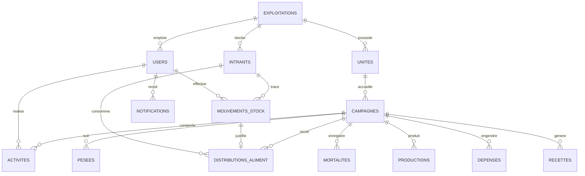

# PorciGest — Plateforme SaaS de gestion d'un élevage porcin (Laravel)

Projet individuel — ESMIA, Licence 3 SIO, module Framework PHP / Laravel (2026).

| Paramètre du sujet | Choix |
|---|---|
| Type d'exploitation | **Élevage porcin** (lots de porcs charcutiers) |
| Module spécialisé | **Alimentation** (distribution d'aliment par lot, coût, consommation) |
| Contrainte métier | **Le stock d'aliment ne doit jamais devenir négatif** lors d'une distribution |
| Module personnel | **Suivi zootechnique** : pesées, mortalité, taux de mortalité (alerte > 5 %), indice de consommation (IC) |

## 1. Installation (Laravel 12, PHP ≥ 8.2)

Ce dépôt contient uniquement le code spécifique au projet (« overlay »), à poser sur une installation neuve de Laravel.

```bash
composer create-project laravel/laravel porcigest
cd porcigest
php artisan install:api          # installe Laravel Sanctum (API + table personal_access_tokens)
# Copier le contenu de ce dossier PAR-DESSUS le projet (app, bootstrap, database, resources, routes, tests, README.md)
# Réponds « oui » à l'écrasement de bootstrap/app.php, routes/api.php, routes/web.php, User.php, UserFactory.php, DatabaseSeeder.php, Controller.php
```

## 2. Configuration de la base de données (`.env`)

SQLite est utilisé par défaut. Pour connecter l'application à MySQL :

1. Démarrer MySQL, puis créer une base et un utilisateur (adapter le mot de passe) :

```sql
CREATE DATABASE porcigest CHARACTER SET utf8mb4 COLLATE utf8mb4_unicode_ci;
CREATE USER IF NOT EXISTS 'porcigest'@'localhost' IDENTIFIED BY 'change-me';
ALTER USER 'porcigest'@'localhost' IDENTIFIED BY 'change-me';
GRANT ALL PRIVILEGES ON porcigest.* TO 'porcigest'@'localhost';
CREATE USER IF NOT EXISTS 'porcigest'@'127.0.0.1' IDENTIFIED BY 'change-me';
ALTER USER 'porcigest'@'127.0.0.1' IDENTIFIED BY 'change-me';
GRANT ALL PRIVILEGES ON porcigest.* TO 'porcigest'@'127.0.0.1';
```

Exécuter ces commandes avec un compte MySQL administrateur. Remplacer `change-me` par le même mot de passe dans les deux blocs SQL et dans `.env`. Les deux comptes hôtes couvrent la résolution locale MySQL, qui peut identifier une connexion TCP vers `127.0.0.1` comme provenant de `localhost`. Si les comptes existent déjà avec un autre mot de passe, `ALTER USER` le met à jour.

2. Vérifier que l'extension PHP `pdo_mysql` est activée (`php -m | grep pdo_mysql`).
3. Dans `.env`, renseigner les identifiants MySQL :

```dotenv
DB_CONNECTION=mysql
DB_HOST=127.0.0.1
DB_PORT=3306
DB_DATABASE=porcigest
DB_USERNAME=porcigest
DB_PASSWORD=change-me
```

4. Recharger la configuration, créer les tables et ajouter les données de démonstration :

```bash
php artisan config:clear
php artisan migrate --seed
```

Cette commande crée les tables et les données de démonstration dans la base MySQL configurée. Ne lancez pas `migrate:fresh` sur une base contenant des données à conserver : cette commande supprime toutes les tables.

Les autres valeurs utiles de `.env` :

```
DB_CONNECTION=sqlite        # remplacer par mysql pour utiliser la configuration ci-dessus
QUEUE_CONNECTION=database   # file d'attente en base (table jobs)
CACHE_STORE=database        # cache en base
MAIL_MAILER=log             # les e-mails d'alerte sont écrits dans storage/logs/laravel.log
```

## 3. Base de données, seeders, lancement

```bash
php artisan migrate --seed         # migrations + données de démonstration
php artisan serve                  # http://127.0.0.1:8000
php artisan queue:work             # worker de queue (notifications, rapports) — dans un 2e terminal
php artisan test                   # tests automatisés
```

### Comptes de démonstration (mot de passe : `password`)

| Exploitation | Rôle | E-mail |
|---|---|---|
| Ferme Soamandrakizay (Antsirabe) | admin | admin@soamandrakizay.mg |
| | responsable | hery@soamandrakizay.mg |
| | agent | faly@soamandrakizay.mg |
| Porcherie Mandrosoa (Fianarantsoa) | admin | admin@mandrosoa.mg |
| | responsable | mino@mandrosoa.mg |
| | agent | toky@mandrosoa.mg |

Pour démontrer l'isolation : se connecter avec chaque exploitation et constater que les données sont distinctes.

## 4. Modèle de données (MCD / diagramme ER)



12 tables métier (exploitations, unites, campagnes, intrants, mouvements_stock, distributions_aliment, activites, productions, depenses, recettes, pesees, mortalites) + users + notifications. Toutes les tables métier portent `exploitation_id`.

## 5. Correspondance avec le cahier des charges

| Exigence | Où dans le code |
|---|---|
| Exploitations / unités / campagnes | `Exploitation`, `Unite`, `Campagne`, `CampagneController`, `CampagneService` |
| Activités techniques | `ActiviteController`, vue `activites/index` |
| Intrants, stocks, mouvements traçables | `Intrant`, `MouvementStock` (stock_initial, entrée, sortie, consommation, ajustement), `StockService` |
| Productions et récoltes | `Production`, `SuiviController@production` |
| Finances, marge = recettes − dépenses | `Depense`, `Recette`, `FinanceService`, `FinanceController` |
| Tableau de bord + 2 indicateurs calculés | `DashboardService` (taux de mortalité moyen, IC moyen, effectif total) |
| Recherche / filtres / tri / pagination | `ActiviteController@index` (aussi campagnes, intrants) |
| Authentification, rôles | `AuthController`, rôles admin / responsable / agent |
| Middleware, Policies, Gates | `EnsureRole` (`role:admin`), `app/Policies/*`, Gates `voir-finances` et `gerer-utilisateurs` |
| Isolation SaaS | trait `BelongsToExploitation` + `ExploitationScope` (scope global), règles `exists` filtrées (`TenantRequest`) |
| Service Laravel | `StockService`, `CampagneService`, `FinanceService`, `ZootechnieService`, `DashboardService` |
| Transaction | `StockService::distribuerAliment` (mouvement + stock + distribution + dépense) |
| Concurrence | `Intrant::lockForUpdate()` dans `StockService::appliquer` |
| Events / Listeners | `StockCritical` → `NotifierStockCritique` ; `CampagneCompleted` → `LancerRapportCampagne` |
| Notification | `StockCritiqueNotification` (canaux `database` + `mail`) |
| Jobs / Queues | `GenererRapportCampagne`, listener `NotifierStockCritique` (ShouldQueue) |
| Cache | `DashboardService::stats()` (10 min, clé par exploitation) |
| API REST | `routes/api.php`, `Api/*Controller`, `*Resource`, Sanctum |
| Validation et sécurité | `app/Http/Requests/*`, CSRF (`@csrf`), XSS (`{{ }}`), `$fillable`, throttle login |
| Journalisation | `App\Support\Audit` → `storage/logs/audit.log` |
| Tests | `tests/Feature/*` |
| Factories / Seeders | `database/factories/*`, `DatabaseSeeder` |

## 6. Explications clés (pour la soutenance)

**Stock jamais négatif.** Toute modification du stock passe par `StockService::appliquer()` : après le verrouillage, le nouveau stock est calculé ; s'il est < 0, `StockInsuffisantException` est levée, la transaction est annulée et rien n'est enregistré. `quantite_disponible` n'est pas dans `$fillable` : impossible de la modifier ailleurs.

**Transaction.** `distribuerAliment` exécute dans un seul `DB::transaction` : contrôle campagne/intrant → mouvement de stock → baisse du stock → distribution rattachée à la campagne → dépense. Une erreur à n'importe quelle étape annule tout (rollback).

**Concurrence.** Deux utilisateurs prennent en même temps les derniers sacs : `lockForUpdate()` (`SELECT … FOR UPDATE`) force la 2ᵉ transaction à attendre la fin de la 1ʳᵉ, puis elle relit le stock à jour et est refusée si insuffisant. (Verrou pessimiste ; sous SQLite le verrou est sans effet car les écritures y sont déjà sérialisées — utiliser MySQL pour démontrer le verrou en conditions réelles.)

**Isolation.** Le scope global ajoute `WHERE exploitation_id = <celle de l'utilisateur>` à toute requête ; une ressource d'une autre exploitation renvoie 404. À la création, `exploitation_id` est affecté par le serveur. Le modèle `User` n'a pas de scope : l'isolation est vérifiée explicitement dans `UserController@toggle`.

**Notification.** Canal `database` (page « Notifications », toujours disponible, historisée) + `mail` (en développement `MAIL_MAILER=log`). Elle est envoyée par un listener en queue : la distribution n'est pas ralentie.

**Cache.** `DashboardService` met les statistiques en cache par exploitation ; le trait `BelongsToExploitation` appelle `invalider()` à chaque `saved`/`deleted` de n'importe quel modèle métier : le tableau de bord n'est jamais obsolète.

**Limite connue.** Les écritures de masse (`Model::where()->update()`) ne déclenchent pas les événements de modèle, donc n'invalident pas le cache : le code utilise `$model->update()` partout.

## 7. API REST

| Méthode | Route | Description |
|---|---|---|
| POST | `/api/login` | retourne un token Sanctum |
| GET | `/api/intrants`, `/api/intrants/{id}` | consultation (authentifié) |
| GET | `/api/campagnes`, `/api/campagnes/{id}` | consultation + indicateurs |
| POST | `/api/distributions` | crée une distribution (201) ; 422 si stock insuffisant ou validation |

```bash
TOKEN=$(curl -s -X POST localhost:8000/api/login -H "Accept: application/json" \
  -d email=faly@soamandrakizay.mg -d password=password | jq -r .token)
curl -H "Authorization: Bearer $TOKEN" -H "Accept: application/json" localhost:8000/api/intrants
```
